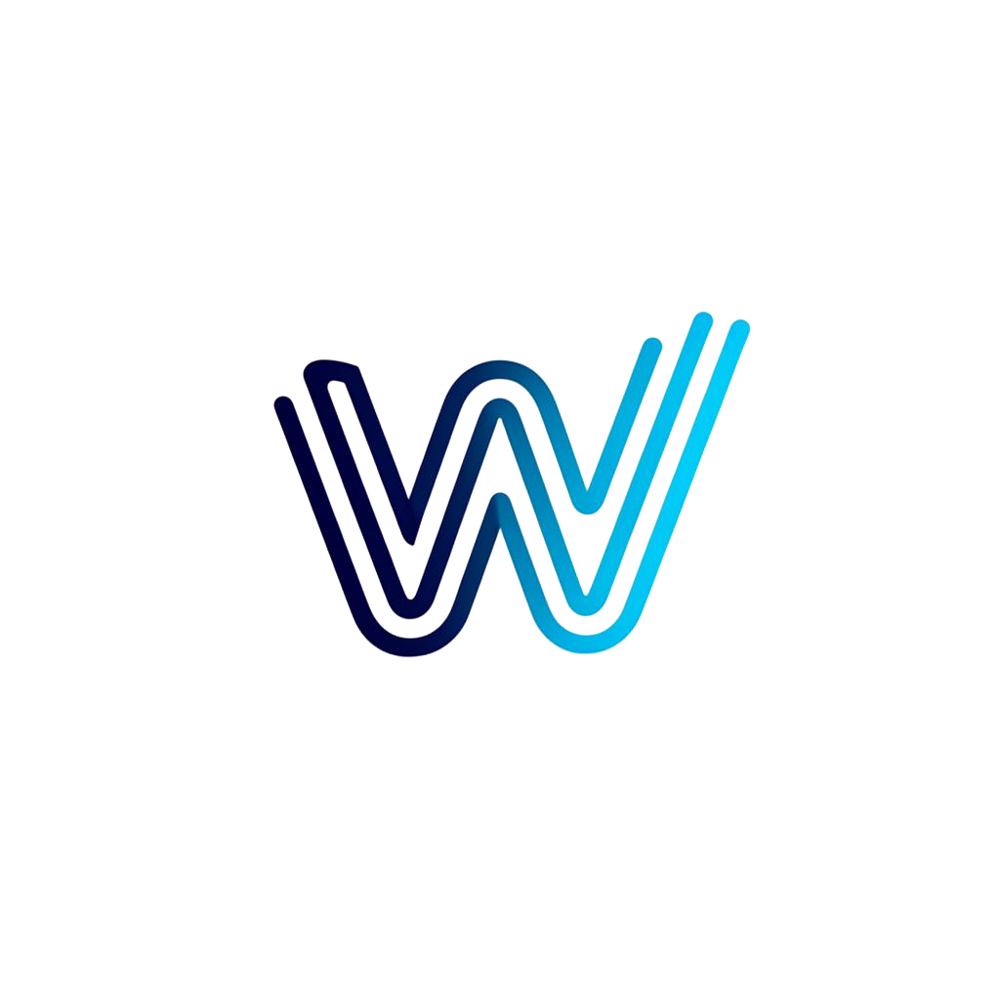

<div align="center">



<h1>WindPulse</h1>

<p><strong>Free & Open Source Android Screen Mirroring for Windows</strong></p>

<p>
  <a href="https://github.com/saadabdullah07bd/WindPulse/releases/latest"></a>
  <a href="https://github.com/saadabdullah07bd/WindPulse/blob/main/LICENSE"></a>
  <a href="https://github.com/saadabdullah07bd/WindPulse/stargazers"></a>
  <a href="https://github.com/saadabdullah07bd/WindPulse/releases"></a>
  <a href="https://github.com/saadabdullah07bd/WindPulse/issues"></a>
</p>

<p>
  <a href="https://github.com/saadabdullah07bd/WindPulse/releases/latest">
    
  </a>
</p>

<p><em>Mirror your Android screen to your PC — wirelessly or via USB. No ads, no tracking, no sign-up.</em></p>

</div>

---

<h2>✨ Features</h2>

<table>
  <tr>
    <td>📱 <strong>USB & Wireless (QR Code)</strong></td>
    <td>Connect via USB or scan a QR code with Android 11+ Wireless Debugging (auto mDNS pairing)</td>
  </tr>
  <tr>
    <td>🦀 <strong>Rust Powered & Lightweight</strong></td>
    <td>Rebuilt with native Rust (Tauri) — drops RAM usage to ~25 MB and startup is instant</td>
  </tr>
  <tr>
    <td>🖥️ <strong>Multiple Devices</strong></td>
    <td>Mirror and manage multiple Android devices simultaneously</td>
  </tr>
  <tr>
    <td>🎮 <strong>Flexible Display Modes</strong></td>
    <td><strong>Mirror</strong> (view + control), <strong>Camera Passthrough</strong>, <strong>Audio Only</strong>, and <strong>Virtual Tablet Display</strong></td>
  </tr>
  <tr>
    <td>⚡ <strong>Low Latency</strong></td>
    <td>Powered by <a href="https://github.com/Genymobile/scrcpy">scrcpy</a> for near-native performance</td>
  </tr>
  <tr>
    <td>🔒 <strong>Privacy First</strong></td>
    <td>No data collection, no ads, no telemetry — ever</td>
  </tr>
  <tr>
    <td>🆓 <strong>100% Free</strong></td>
    <td>Open source under MIT License — free forever</td>
  </tr>
</table>

---

<h2>📸 Screenshots</h2>

<div align="center">
  <p><em>Screenshots coming soon</em></p>
</div>

---

<h2>🚀 Installation</h2>

<h3>Quick Install (Recommended)</h3>

<ol>
  <li>Download <a href="https://github.com/saadabdullah07bd/WindPulse/releases/download/v2.1.0/WindPulseV2.0.Setupx64.exe"><strong>WindPulseV2.0.Setupx64.exe</strong></a> from <a href="https://github.com/saadabdullah07bd/WindPulse/releases/latest"><strong>Releases</strong></a></li>
  <li>Run the installer</li>
  <li>Launch WindPulse from your desktop</li>
  <li>Connect your Android device via USB or Wi-Fi</li>
</ol>

<h3>System Requirements</h3>

<table>
  <tr>
    <td><strong>OS</strong></td>
    <td>Windows 10 / 11 (64-bit)</td>
  </tr>
  <tr>
    <td><strong>Android</strong></td>
    <td>Android 11+ (API 30+)</td>
  </tr>
  <tr>
    <td><strong>USB</strong></td>
    <td>USB Debugging enabled on your device</td>
  </tr>
  <tr>
    <td><strong>Wi-Fi</strong></td>
    <td>Both devices on the same network</td>
  </tr>
</table>

<h3>Build from Source</h3>

```bash
# Clone the repository
git clone https://github.com/saadabdullah07bd/WindPulse.git
cd WindPulse

# Install frontend dependencies
npm install

# Build frontend and Rust native application
npm run build
cargo build --release --manifest-path src-tauri/Cargo.toml
```

---

<h2>📱 How to Connect Your Device</h2>

<h3>USB Connection</h3>

<ol>
  <li>Enable <strong>Developer Options</strong> on your Android device</li>
  <li>Enable <strong>USB Debugging</strong> in Developer Options</li>
  <li>Connect your device via USB cable</li>
  <li>Open WindPulse and click <strong>Connect</strong></li>
</ol>

<h3>Wireless Connection (QR Code - Recommended)</h3>

<ol>
  <li>Enable <strong>Wireless Debugging</strong> in Developer Options (Android 11+)</li>
  <li>In WindPulse, open <strong>Wireless Pairing</strong> and click <strong>Pair with QR Code</strong></li>
  <li>On your phone, tap <strong>Pair device with QR code</strong> and point your camera at the screen</li>
  <li>WindPulse will automatically discover, pair, and connect via mDNS!</li>
</ol>

---

<h2>🏗️ Tech Stack</h2>

<table>
  <tr>
    <td><strong>Backend</strong></td>
    <td>Rust (Tauri native Windows runtime)</td>
  </tr>
  <tr>
    <td><strong>Frontend</strong></td>
    <td>React + TypeScript + Tailwind CSS + shadcn/ui</td>
  </tr>
  <tr>
    <td><strong>Mirroring Engine</strong></td>
    <td>scrcpy + ADB</td>
  </tr>
</table>

---

<h2>🤝 Contributing</h2>

<p>Contributions are welcome! Please read the <a href="CONTRIBUTING.md">Contributing Guide</a> before submitting a pull request.</p>

---

<h2>📄 License</h2>

<p>This project is licensed under the <a href="LICENSE">MIT License</a> — free to use, modify, and distribute.</p>

---

<div align="center">
  <p>Built with ❤️ by <a href="https://github.com/saadabdullah07bd">Saad Abdullah</a></p>
  <p>
    <a href="https://github.com/saadabdullah07bd/WindPulse/stargazers">⭐ Star this repo</a> if you find it useful!
  </p>
</div>
